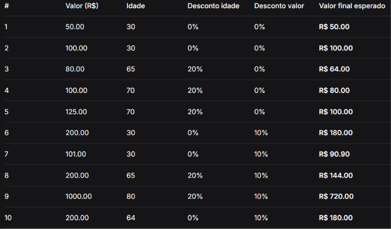

# Ponto de Venda (PDV) com Descontos Progressivos

## O que o código faz
Este programa simula o caixa de uma loja (PDV). Ele recebe o valor da compra e a idade do cliente, aplica os descontos correspondentes, mostra o valor final formatado em reais e guarda tudo em listas para exibir um resumo do dia ao encerrar.

## Como ele faz
1. **Pergunta Inicial**: Pede `S` para começar ou `N` para sair.
2. **Entrada e Validação**:
   - Pede o valor da compra. Se digitar `0`, encerra o programa (`break`). Se for negativo, mostra um aviso e pede de novo (`continue`).
   - Pede a idade do cliente. Se for negativa, mostra um aviso e pede de novo (`continue`).
3. **Desconto por Idade**: Se a idade for 65 ou mais, dá 20% de desconto.
4. **Desconto por Valor**: Se o valor da compra (já com o desconto de idade) for maior que R$ 100, dá mais 10% de desconto.
5. **Histórico**: Salva o valor original, idade e valor final nas listas com `.append()`.
6. **Exibição**: Mostra os detalhes da compra no terminal.
7. **Resumo Final**: Ao digitar `0`, exibe o total de compras, valor bruto, total de descontos e valor final usando `len()` e `sum()`.
## Tabela de exemplos : 


## Como rodar
Abra o terminal na pasta do projeto e digite:

```bash
python pdv.py